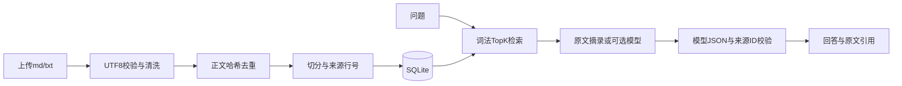

# 企业资料检索与证据问答助手

这是 Rain 的实习学习项目教学基线，由 Codex 创建。学生尚未完成个人实操验收；不能把本仓库的测试通过直接写成学生独立开发经验。

默认模式是中文双字词和英文词 TF-IDF 检索，再展示原文摘录。它不是语义 Embedding，也没有自动调用真实模型。`llm` 模式可调用兼容 `chat/completions` 的 HTTPS 服务，但尚未真实接入验证。

## 本机启动

当前机器的虚拟环境和依赖已经安装，进入此目录后执行：

```bash
./.venv/bin/python -m uvicorn app.main:app --host 127.0.0.1 --port 8000
```

浏览器打开 `http://127.0.0.1:8000`。接口文档在 `/docs`，上传 `data/demo/policy.md` 和 `faq.md`，提问“重复导入文档如何处理？”。

新环境安装：Python 3.9 或更高版本；实际只验证了本机 3.9.6。其他版本要重测依赖。

```bash
python3 -m venv .venv
./.venv/bin/python -m pip install -r requirements.txt
./.venv/bin/python -m uvicorn app.main:app --host 127.0.0.1 --port 8000
```

Python 3.9 是本机现状，不作为新服务器版本推荐。Dockerfile 使用 Python 3.11 基础镜像，尚未构建验证；本机没有 Docker。

## 测试与诊断集

```bash
./.venv/bin/python -m pytest -q tests
./.venv/bin/python scripts/evaluate.py
```

第一条验证核心逻辑/API以及模拟模型错误；没有真实模型请求。第二条在临时数据库导入两份原创教学资料，报告在 `reports/baseline_eval.json`。这是很小的诊断集，包含有重叠关键词但文档没有答案的困难负例；存在召回不等于存在答案。不要据此宣称企业准确率。

第一天只做自己的练习：

```bash
./.venv/bin/python exercises/day01.py
./.venv/bin/python exercises/check_day01.py
```

第一次出现 `NotImplementedError` 是预留练习，不是服务故障。题目在上一级的 `第1天开始.md`；这个练习不计入基线测试通过统计。

## 请求与存储

| 接口 | 输入 | 结果 |
|---|---|---|
| POST /documents | multipart file，UTF-8 md/txt，≤2 MiB | 文档ID、切片数、是否重复 |
| GET /documents | 无 | 已导入文档与切片数 |
| DELETE /documents/{id} | 文档ID | 删除文档与切片；历史暂保留 |
| POST /query | question，top_k=1..10，mode=extractive/llm | answer、sources、mode、status、usage |
| GET /history | 无 | 最近20条已完成问答 |
| GET /health | 无 | 健康状态和默认检索模式 |

SQLite 表：`documents(id,name,content_hash)`、`chunks(id,document_id,text,start_line,end_line)`、`queries(id,question,answer,mode,created_at)`。正文 SHA-256 唯一；切片外键级联删除；SQL 均用参数绑定。源文件不被移动或写入，只读取上传正文。



摘录模式直接展示片段，不走模型校验。无关键词重叠时拒答；有关键词重叠但答案不在资料内的情况目前可能错误放行，是第10天必须调查的缺陷。

## 真实模型接入

先选择供应商并核查其接口协议、资料使用条件、模型名称与价格。基线没有默认供应商、默认模型或费用承诺。

在本机服务端环境设置 `LLM_BASE_URL`（通常包括 `/v1`）、`LLM_MODEL` 和 `LLM_API_KEY` 后，再启动服务。密钥不要发到聊天，不要提交 Git。`.env.example` 只是配置说明，当前代码不会自动加载 `.env`；使用 IDE 的环境变量配置或终端读取方式即可。

`llm` 模式会把问题和检索到的片段发送到该供应商。每次问答最多3段（默认各≤500字符），输出上限800 tokens；token数与字符数不是同一单位。设置请求次数上限和账号预算后，用usage与账单计算真实成本。适配器设置连接5秒、网络操作20秒超时，不自动重试。无法支持此协议的供应商需另写适配器。

服务端验证 JSON 格式和引用ID是否来自本次召回；这不能证明答案每句话都有证据。必须另做逐句人工核查与真实模型评测。

## 必须由学生完成的部分

详见上一级 `项目实战指导.md`：文本统计、CSV清洗、接口变式、完整文档导入、固定评测集、真实模型接入与异常验证、检索失败修复、部署和项目讲解。语义检索、PDF解析和SSE是范围可调整的拓展；未完成时删除简历里的对应技能。

## 当前限制

- 仅本机个人演示：未实现鉴权、多用户隔离、数据备份和公网部署。
- 每次加载全部切片并重建词法索引，暂不适合大规模服务。
- 不支持PDF/Word/OCR；长文本按字符切分，章节边界优化由学生完成。
- 真实模型、语义Embedding、Docker/Linux部署均未验收。
- 课程资料仅用于本地学习；公开项目仓库只保留原创示例、代码与公开可用资料。

## 已核对的官方参考

- [FastAPI 文件上传](https://fastapi.tiangolo.com/tutorial/request-files/)
- [FastAPI 测试](https://fastapi.tiangolo.com/tutorial/testing/)
- [Python sqlite3 参数绑定](https://docs.python.org/3/library/sqlite3.html)
- [HTTPX 超时](https://www.python-httpx.org/advanced/timeouts/)

查询日期：2026-10-12。实际依赖版本以 requirements.txt 和 requirements.lock.txt 为准。
